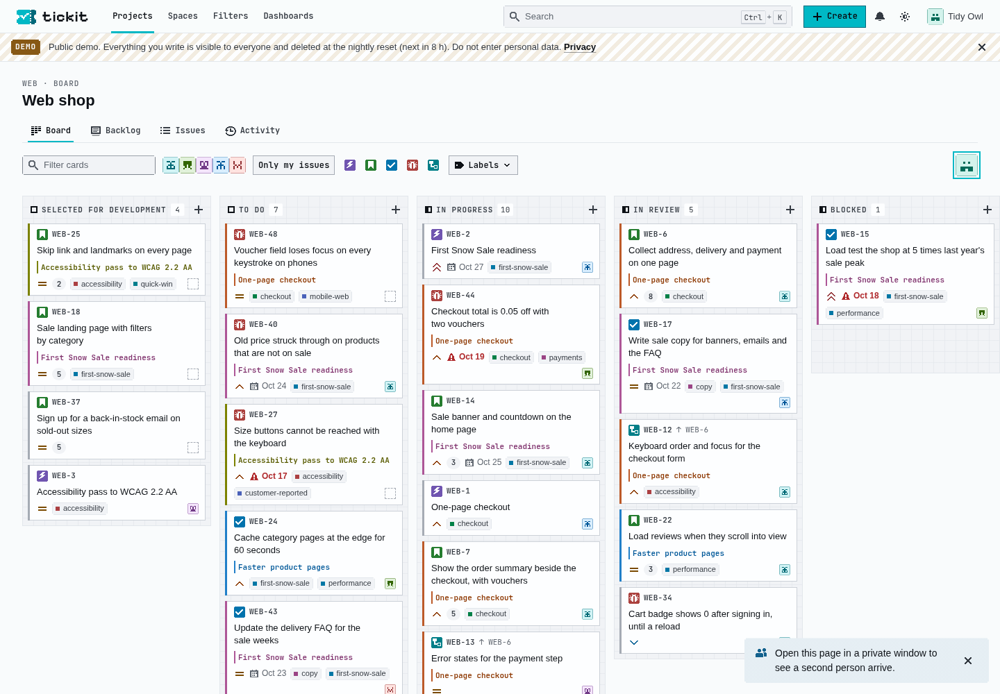

# tickit

[](https://github.com/zweiundeins/tickit/actions/workflows/ci.yml)
[](go.mod)
[](#develop)
[](https://github.com/zweiundeins/lith)
[](https://data-star.dev)
[](https://tickit.zweiundeins.gmbh)

**An issue tracker and a wiki that several people use at once.** Open a board, a page or an issue and see the others on it, their moves on the board, their keystrokes in the page and their changes to the issue as they happen. tickit is the public demo of [lith](https://github.com/zweiundeins/lith), built by [zwei und eins gmbh](https://zweiundeins.gmbh).

Go · templ · SQLite · lith · Datastar + Rocket · event sourcing · ProseMirror. One binary, one database file.



## Features

- **No account needed:** each browser is a guest with a pseudonym and a pixel face ("Sunny Otter"). Open a private window to see a second person arrive. Accounts are for staff, who moderate and run the demo.
- **Projects and issues:** keys such as `WEB-12`, seven statuses in a workflow, types, priorities, assignees, labels, components, sprints, story points, estimates, due dates, parents, links, watchers, comments with mentions, a full history, and every issue as it stood at any earlier version.
- **A live board:** drag a card, or move it by keyboard from its menu. It moves at once, marked pending, and other browsers see it 22 to 74 ms later. Of two people who move one card at once, the second reads "Sunny Otter moved WEB-12 to In Review first".
- **Field conflicts in words:** "Sunny Otter changed the priority to High 5 seconds ago. Your Critical was not saved.", with a button to save yours anyway.
- **Pages, co-edited:** a page tree per space, templates, labels, the trash, versions with a slider, compare and restore, comments with replies, and issue chips that show an issue's live status. Up to 20 people type in one paragraph: the server orders and rebases every edit, so nobody's keystroke is lost, and everyone sees the others' carets.
- **Search and lists:** one index over issues, comments and pages with a typeahead in the header; a filtered, sorted, paged issue list that every tab with the same filter shares as one live view; saved filters; CSV export.
- **Live everywhere:** faces of the people on an issue, a board or a page, "is typing" indicators, a bell that every tab of a person updates, activity feeds, and a reconnect after a deploy without a reload.
- **Run as a public demo:** seeded content (Alpenglow, a fictional Swiss outdoor shop, with 30 days of history), a nightly reset at 04:00 Zurich time announced ten minutes ahead, rate limits and daily caps, moderation, and administration pages.
- **A design system of its own:** a sibling of Starbase and lith's site with 8-bit corners, light and dark themes, pixel icons and Starbase components, at [/design](https://tickit.zweiundeins.gmbh/design).

## Try it

Open [tickit.zweiundeins.gmbh](https://tickit.zweiundeins.gmbh) in two windows, one of them private, and move a card or type in a page. Everything there is public and goes at the nightly reset.

## Develop

You need Go 1.27.2 (`go` fetches it with `GOTOOLCHAIN=auto`). No Node: the editor's bundle is committed.

```sh
go tool task dev     # http://127.0.0.1:8080, seeded on first start, rebuilt on every change
go tool task test    # vet, formatting, go test ./...
go tool task build   # the static binary, everything embedded
```

`-dev` writes the seed into an empty database (`data/tickit.db`). To seed by hand: `go run ./cmd/tickit seed -db data/tickit.db` (`-force` empties a database first and keeps its staff accounts). After editing a `.templ` file run `go tool templ generate`; the generated files are committed. `tickit serve -h` lists every setting; each can also come from the environment, `-db` as `TICKIT_DB`.

A staff account, on the host as the user that runs tickit:

```sh
TICKIT_PASSWORD='…' tickit account create -db /var/lib/tickit/tickit.db \
    -email ada@example.com -username ada -name 'Ada Brunner' -role admin
```

The role is `none`, `moderator` or `admin`. Without `TICKIT_PASSWORD` the password is read from standard input; it is never a flag.

## Tests

```sh
go tool task test-race   # the race detector: slow, for milestones
go tool task e2e         # browsers: CHROME=/usr/bin/chromium, LITH_CHROME_NO_SANDBOX=1 without a sandbox
go tool task security    # the security suite, fuzzers, the binary's smoke check, govulncheck
go tool task load        # 200 streams against the built binary (NFR-38)
```

| Kind | What it checks |
| --- | --- |
| Server and commands | every action, view and page in process behind the whole edge (`internal/web/webtest`), commands on a fresh database (`internal/dbtest`), a rebuild of every read model from the events; tests name the requirement they prove (`// FR-11.2`) |
| Browsers | two to twenty Chromium tabs: live moves and conflicts, presence, co-editing that converges, a restart while typing, axe on the main pages, nothing wider than 320 px |
| Security | every action as each kind of person without the right answers 403 and changes nothing, cross-site posts, every GET leaves the database unchanged, no secret in a log, malformed input and fuzzing of every action family |
| Load | 10,000 issues, 2,000 pages and 1,000,000 events, 200 streams, a card move a second, 20 editors typing, a restart that every stream survives |
| Document core | the Go port of ProseMirror against the real one, run in goja inside `go test`, byte for byte, plus a fuzzer |

## How it works

- **One writer:** every change is a `POST /cmd/...` action that becomes a command; lith's writer applies them in order, one transaction a batch, a savepoint each. The actor comes from the session, never from the request.
- **Event sourcing:** projects, issues, comments, spaces, pages and page documents are streams in `lith/events`. Deciders decide from a stream's state row, inline projectors keep the read models in the same savepoint, and catch-up projectors send the notifications.
- **Views, not APIs:** each region of a page is a view with a key and topics. A commit marks the views of its topics, and in the next tick lith renders each changed view once for every tab that watches it; Datastar morphs the frame in. Outcomes and refusals travel in the tab's own view.
- **Co-editing:** ProseMirror in a Rocket component sends its steps as an action's payload. The writer maps a stale commit over the newer ones with a Go port of prosemirror-transform and appends it at the head; each editing tab's view carries every commit since the version it acknowledged, so a skipped frame loses nothing. No CRDT.

[docs/architecture.md](docs/architecture.md) has the cut of the code, [docs/editor.md](docs/editor.md) the co-editing protocol.

## Measured

On a development machine (i5-13500), against the built binary with 10,000 issues, 2,000 pages, 1,000,000 events and 200 open streams ([benchmarks/RESULTS.md](benchmarks/RESULTS.md)):

- **Actions:** 32,150 answered 204 at p50 0.6 ms and p95 3.6 ms.
- **Commit to screen:** a card move reaches the 100 board tabs at p50 53 ms and p95 77 ms, an upper bound measured at the client.
- **Co-editing:** 20 browsers typing 5 characters a second each, keystroke to the other editors at p95 152 ms on loopback, every document identical at the end; the writer spends 0.25 ms a commit.
- **Frames:** a board of 100 cards in about 60 KB, 25 issue rows in 36 KB; one render a tick however many tabs watch.
- **Restart:** every one of the 200 streams back with current frames 1.0 s after `/healthz`.

## Project

- [docs/requirements.md](docs/requirements.md): what tickit must do; [docs/status.md](docs/status.md): which requirements are done and the tests that prove them.
- [docs/security.md](docs/security.md), [docs/accessibility.md](docs/accessibility.md), [docs/design-system.md](docs/design-system.md).
- [docs/deploy.md](docs/deploy.md) and [deploy/](deploy/README.md): the host, deploys with health checks and rollback, backups, monitoring.
- [AGENTS.md](AGENTS.md): the layout and the project's rules, for people and coding agents.

| Path | What it holds |
| --- | --- |
| `cmd/tickit` | the binary: `serve`, `backup`, `seed`, `account create`, `migrations-pending` |
| `internal/` | domain packages (`people`, `access`, `tabs`, `tracker`, `wiki`, `doc`, `markup`, `search`, `notify`, `activity`, `demo`), the design system (`ui`), the pages (`views`) and the server (`web`) |
| `editor/` | the source of the `sb-rich-editor` component; its bundle is committed in `internal/web/static/editor/` |
| `e2e/` | browser tests of the multiplayer criteria |
| `cmd/tickit-load`, `benchmarks/` | the load test and the measured numbers |

## Credits

Built on [lith](https://github.com/zweiundeins/lith), with components from [Starbase](https://github.com/zweiundeins/starbase) and the pattern of lith's board, Town in time and cursor party demos. The editor is [ProseMirror](https://prosemirror.net) with the commit protocol of [prosemirror-collab-commit](https://github.com/stepwisehq/prosemirror-collab-commit).

## Licences

Third-party code and assets keep their licences: Datastar and Rocket (MIT, `internal/web/static/vendor`), Starbase's components (MIT, `internal/web/static/vendor/starbase`), ProseMirror and prosemirror-collab-commit (MIT, `internal/web/static/editor/LICENSES.txt`), Pixelify Sans and JetBrains Mono (SIL OFL, `internal/web/static/fonts`).

## Maintainer

Maintained by [zwei und eins gmbh](https://zweiundeins.gmbh), Aarberg, Switzerland.
